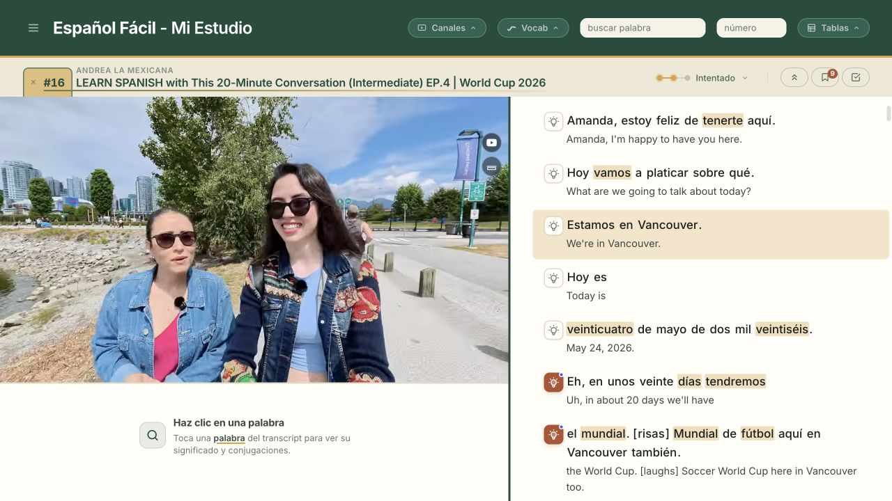
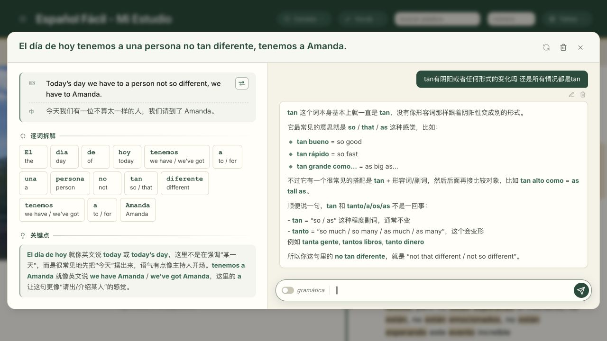

# Español Fácil

**A personal Spanish-learning workspace that brings vocabulary, sentence and grammar support into the videos I want to watch.**

*Video and a Spanish–English transcript share one workspace. Unfamiliar language can be explored alongside the original content.*

## From watching to understanding

1. **Follow a chosen video** with its Spanish–English transcript.
2. **Explore an unfamiliar word or sentence** through contextual lookup, explanations and verb reference.
3. **Ask a follow-up question** about the language in that sentence.
4. **Return to the video**, keeping the original content at the centre of the study session.

*An existing sentence explanation includes a word breakdown and follow-up discussion. The question asks whether **tan** changes with gender; the response contrasts it with **tanto/a/os/as**. Explanations are in Chinese in this personal study setup.*

## Why I built it

I wanted to learn Spanish through comprehensible input: learning from meaningful content in the language. As a beginner, my vocabulary and familiarity with sentence structure, grammar and verb tenses were not yet sufficient to understand much of a video.

I had not found a tool that brought the support I needed together with the videos I wanted to watch. Español grew from that personal need: make chosen content more accessible while continuing to learn from it.

## Design choice: keep earlier examples connected to the current lesson

As my study progressed, I added “Visto antes” review to connect a word with examples from material already encountered. It distinguishes the clicked form from related inflections, so an earlier occurrence of that word and a different form are not treated as the same match.

The review flow also preserves playback and lookup context when moving between episode tabs. A learner can inspect an earlier example and keep a route back to the original study session.

Iterations around subtitle timing, word-history updates and state restoration support this continuity between watching, looking something up and revisiting earlier material.

## My role and project stage

I defined the product concept and feature direction, used the application for my own learning, and reviewed iterations. Implementation was primarily completed with AI assistance.

Español is a personal project run locally on desktop. Its usefulness is based on my own learning experience.

**Project stack:** JavaScript ES modules, Python/Flask, JSON data and a SQLite runtime layer. AI services support transcription, translation, dictionary lookup and explanations.
