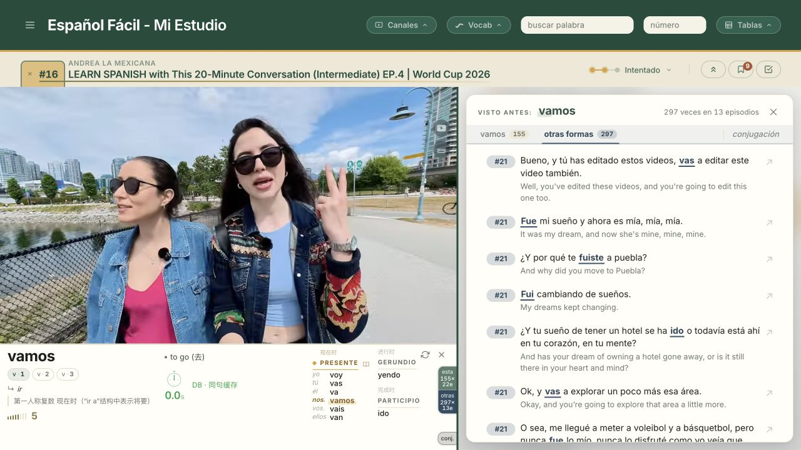
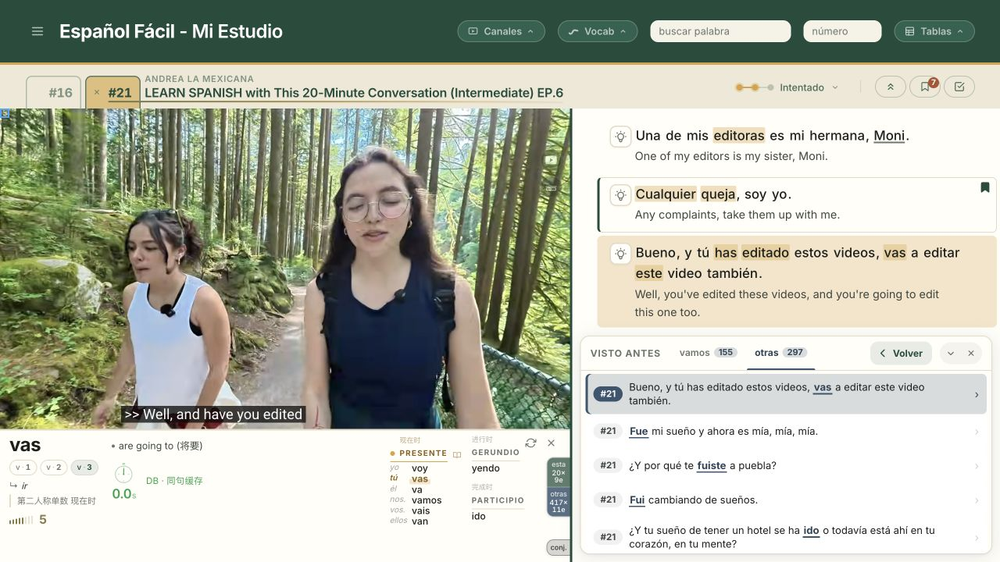

# Español Fácil

**A personal Spanish-learning workspace that brings vocabulary, sentence and grammar support into the videos I want to watch.**

*Video and a Spanish–English transcript share one workspace. Unfamiliar language can be explored alongside the original content.*

## From watching to understanding

1. **Follow a chosen video** with its Spanish–English transcript.
2. **Explore an unfamiliar word or sentence** through contextual lookup, explanations and verb reference.
3. **Ask a follow-up question** about the language in that sentence.
4. **Return to the video**, keeping the original content at the centre of the study session.

*An existing sentence explanation includes a word breakdown and follow-up discussion. The question asks whether **tan** changes with gender; the response contrasts it with **tanto/a/os/as**. Explanations are in Chinese in this personal study setup.*

## Why I built it

I wanted to learn Spanish through comprehensible input: learning from meaningful content in the language. As a beginner, my vocabulary and familiarity with sentence structure, grammar and verb tenses were not yet sufficient to understand much of a video.

I had not found a tool that brought the support I needed together with the videos I wanted to watch. Español grew from that personal need: make chosen content more accessible while continuing to learn from it.

## One click from a word form to its original video context

I wanted vocabulary review to reconnect with language I had actually heard. From a word card, “Visto antes” finds sentences in material already encountered, with separate groups for the exact word form and related conjugations.

For example, looking up **vamos** also surfaces forms such as **vas**, **fui** and **ido**. Clicking a result opens its source video at the relevant sentence and starts playback, with the sentence highlighted in the transcript. The same word and its conjugations are one click away from being heard in context.

*Exact-form matches and other conjugations have separate tabs. Matched words are underlined, and episode badges identify where each sentence came from.*

## Interaction details: explore without losing your place

*One click on the **vas** example opens episode **#21** at that sentence. The original lesson, **#16**, remains in the top tab strip; the review dock keeps the selected example and a **Volver** (return) control visible.*

- **Keep the original session intact.** Switching episode tabs preserves the playback position, transcript scroll and active word card. Tabs keep their opening order, so navigating does not rearrange the controls.
- **Keep review beside the content.** A dock holds the matching sentences while the source video and transcript remain visible. It can be minimised for reading space, and its return control takes the learner back to the originating lesson.
- **Keep grammar detail proportional to the question.** The word card foregrounds the current form and relevant tense, while a separate conjugation reference provides the fuller table on demand.

These details reflect ongoing refinements to subtitle timing, word-history updates and state restoration around the way I actually study.

## My role and project stage

I defined the product concept and feature direction, used the application for my own learning, and reviewed iterations. Implementation was primarily completed with AI assistance.

Español is a personal project run locally on desktop. Its usefulness is based on my own learning experience.

**Project stack:** JavaScript ES modules, Python/Flask, JSON data and a SQLite runtime layer. AI services support transcription, translation, dictionary lookup and explanations.
